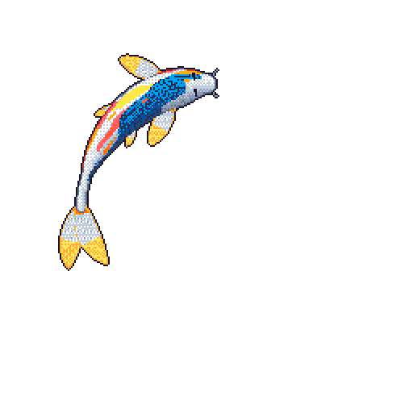

<h1 align="center">Aryaman Tepal</h1>

  
   
  Drawn by <a href="https://github.com/yalongwastaken/git-koi">git-koi</a>

I am a senior in Computer Science and Applied Mathematics at UMass Amherst, graduating May 2027.

At the [Linot Lab](https://linotlab.github.io), I am developing algorithms to predict fluid velocity fields from streaklines. I spent summer 2026 at Edgescale AI.

I'm currently working on building agents in long-horizon planning through competitive battling and RPG speedrunning in [Pokémon](https://arena.aryamantepal.com).

[aryamantepal.com](https://aryamantepal.com) · [X @aryamantepal](https://x.com/aryamantepal) · [LinkedIn](https://www.linkedin.com/in/aryamantepal/) · [atepal@umass.edu](mailto:atepal@umass.edu)
